# 选择性对焦编辑人像海报 Skill / Selective Focus Portrait Poster Skill

## 作品展示 · Gallery

以下海报均由本 Skill 生成。

| | | | |
|---|---|---|---|
| 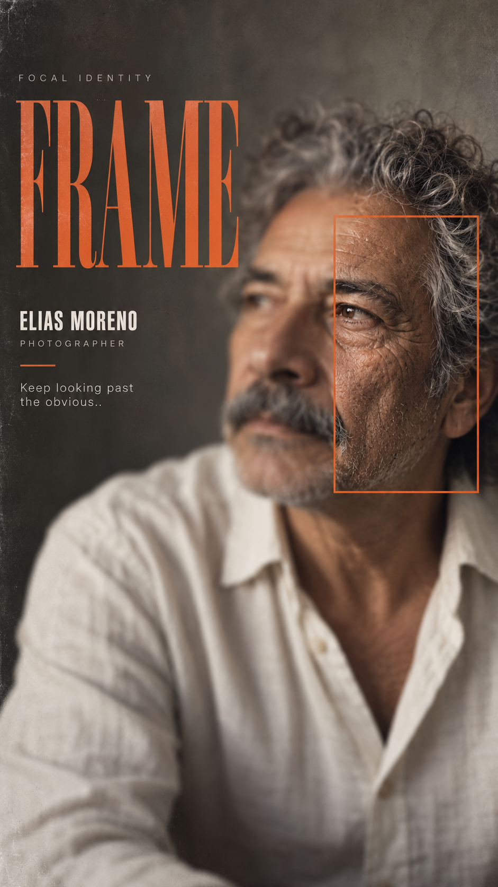 | 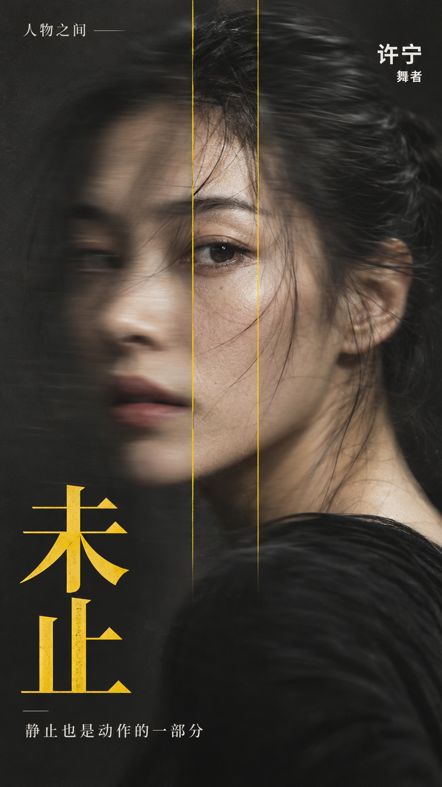 | 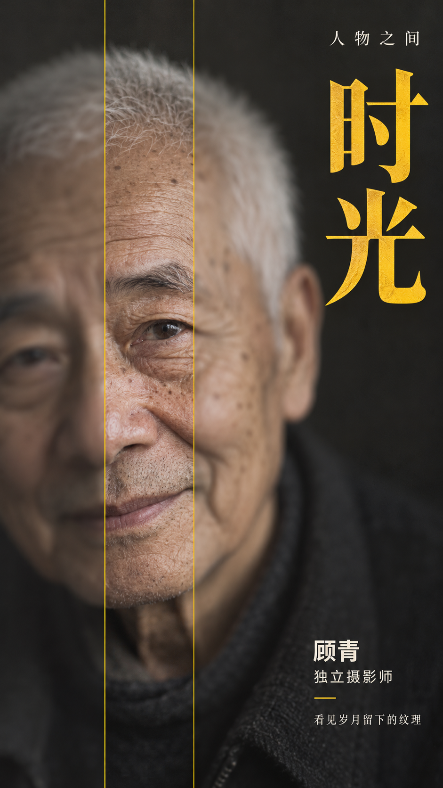 | 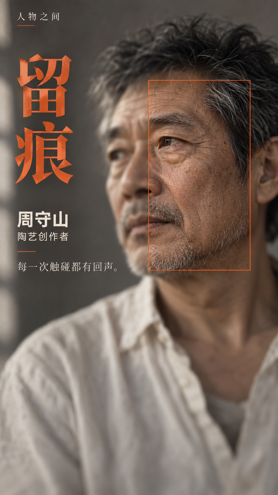 |
| FRAME · offset focus frame | 未止 · vertical sharp slice | 时光 · vertical sharp slice | 留痕 · offset focus frame |
| 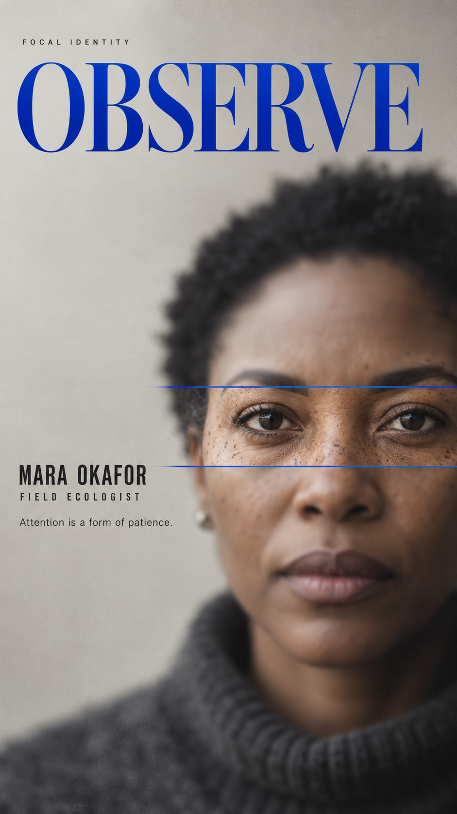 | 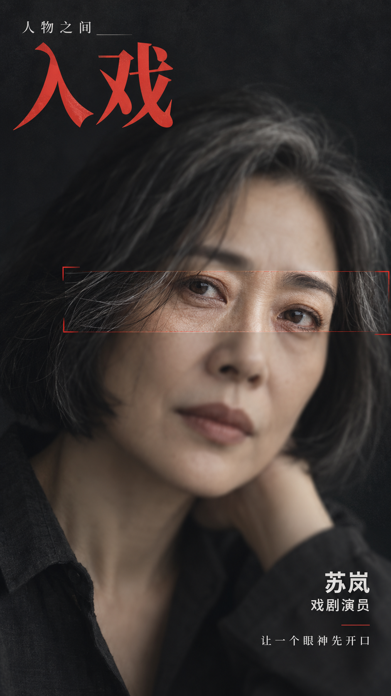 | 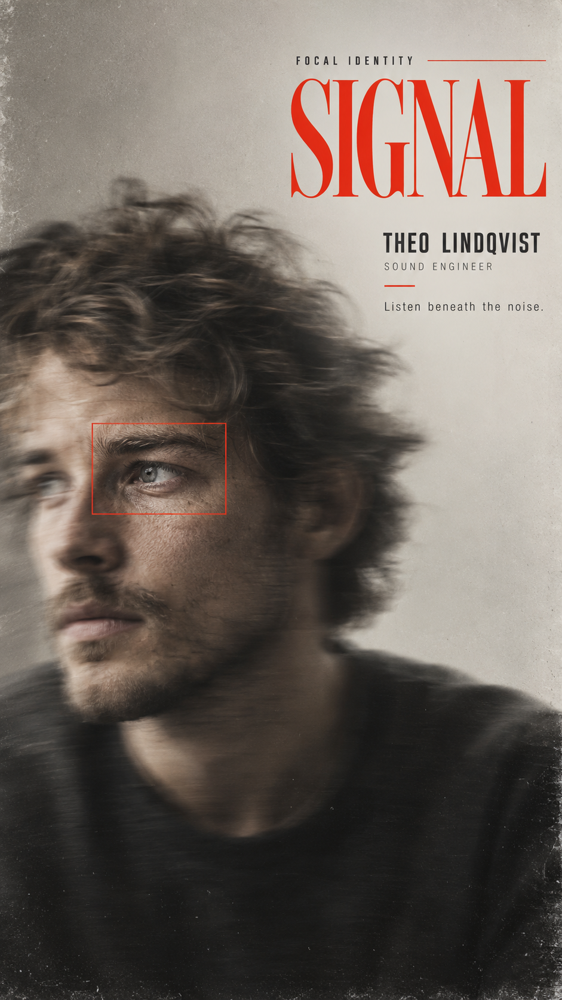 | 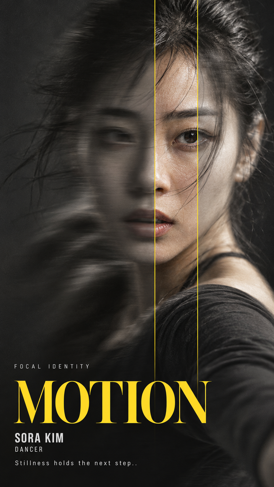 |
| OBSERVE · horizontal sharp slice | 入戏 · horizontal sharp slice | SIGNAL · floating focus window | MOTION · vertical sharp slice |
| 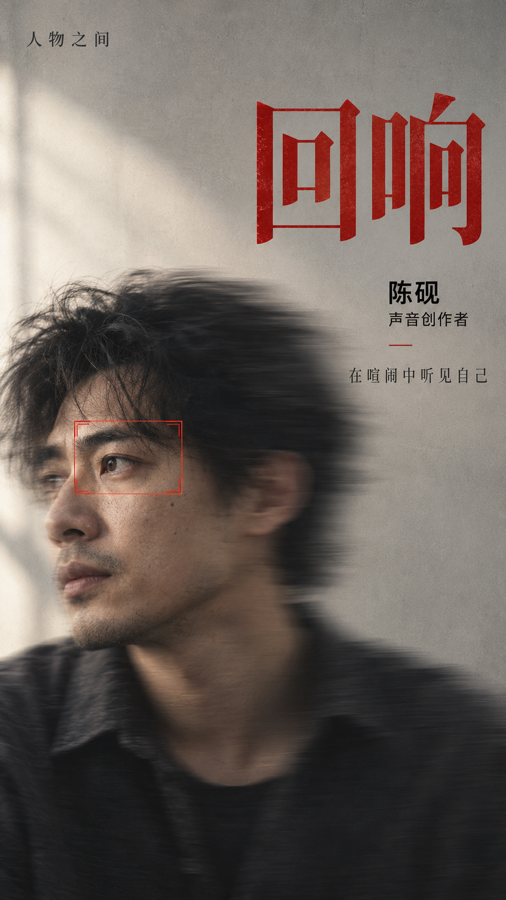 | 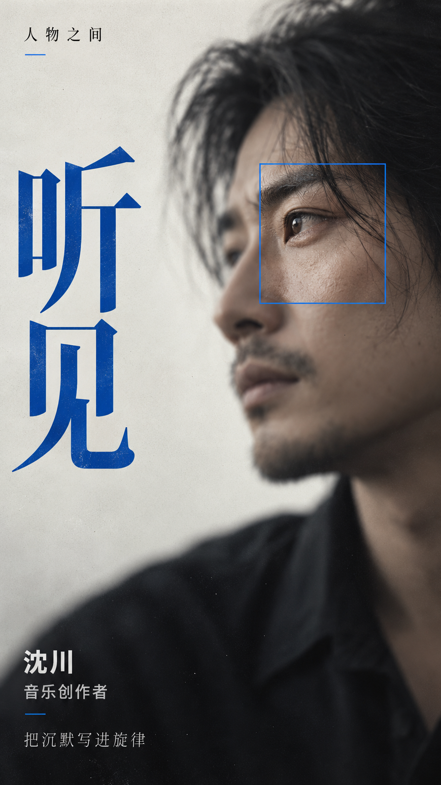 | 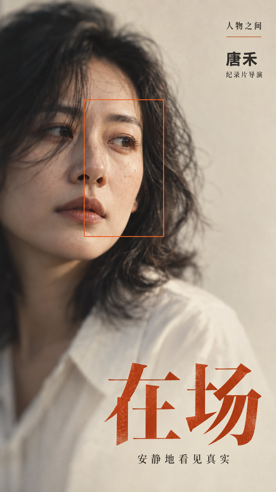 | 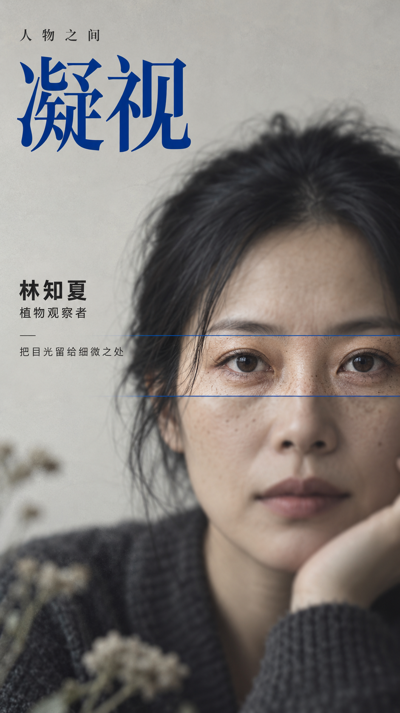 |
| 回响 · floating focus window | 听见 · floating focus window | 在场 · offset focus frame | 凝视 · horizontal sharp slice |


一张 9:16 写实编辑人像海报：人像大部分柔焦，只有一个对焦区域锐利清晰——让模糊与清晰来控制视线。

## 它能做什么
- 真实皮肤纹理的写实人像，拒绝塑料皮肤与过度修图
- 四种对焦结构：横向清晰切片 / 浮动对焦窗 / 竖向清晰切片 / 偏移对焦框
- 中性色场 + 唯一强调色（黄 / 红 / 钴蓝 / 铁锈橙）
- 衬线主标题、窄体粗无衬线姓名与身份、有意义的 Key Line
- 缺失字段自动补全，人物默认虚构，不描绘真实可识别人物

## 安装
**作为 Agent Skill（Claude Code / Cursor / Codex 等）**：

```bash
git clone https://github.com/ericchan916/selective-focus-portrait-poster-skill.git
cp -r selective-focus-portrait-poster-skill ~/.claude/skills/selective-focus-portrait-poster
# 或 ~/.cursor/skills/、~/.codex/skills/ 等
```

**在 ChatGPT / 其他图像模型中使用**：复制 [`prompt.md`](prompt.md) 里的完整英文提示词，填入字段即可。

## 使用示例
```
Main Title: MOTION
Subject: woman, mid 20s, contemporary dancer
Accent Color: yellow
Focus Method: vertical sharp slice
```
或只写：`Main Title: OBSERVE`

更多示例见 [`examples/subjects.md`](examples/subjects.md)。

## 对焦结构
| 方式 | 效果 |
|---|---|
| horizontal sharp slice | 横穿双眼的清晰横带 |
| floating focus window | 小窗口隔离面部局部 |
| vertical sharp slice | 窄竖条穿过运动模糊 |
| offset focus frame | 偏移大框，把视线移离面部中心 |

## English
**Selective Focus Portrait Poster** creates one 9:16 realistic editorial portrait where most of the face is softly blurred and a single focus area returns to sharp detail, with a neutral field plus one accent color and magazine-grade typography. Copy the folder into your agent's skills directory, or paste `prompt.md` into ChatGPT or any image model.

## License
MIT © 2026 Joy Robinson — 见 [LICENSE](LICENSE)。生成图片的使用请同时遵守你所用图像模型的服务条款。
